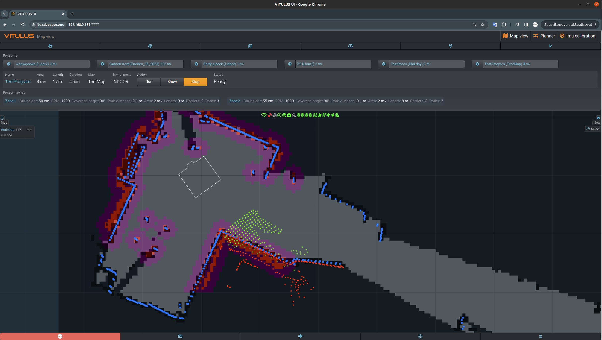

# vitulus_navi
 VITULUS navigation manager.\
 ROS package\
 It's the backend for webUI and manage maps and navigation.
   
 



## Geofence proposals (`src/vitulus_navi/geofence/`)

Robot-native, **propose-only** writer that turns a perimeter *clicked* in the
web-UI map editor into an **UNSIGNED** geofence proposal. It lives here (a
safety-adjacent nav package that ships with the robot) so the public web node
`vitulus_ui/nodes/webnode` (`:7779`) can serve `POST /api/geofence/propose`
without importing anything from the private agent (`vitulus_claude`).

- `fence.py` — verbatim copy of the agent's `geofence.py` (the `Fence`
  geometry/validation the test supervisor also uses; pure stdlib).
- `sitebundle.py` — verbatim copy of the agent's `sitebundle.py`.
- `propose.py` — propose-only port of the agent's `geofence_propose.py`:
  `build_proposal()` / `write_proposal()` convert `map` metres → UTM33, reject
  rings that cross unmapped cells, and write `geofence.proposed.geojson` next to
  the site bundle. Because `fence.py` is a verbatim copy, the ring digest and
  file format match the agent path bit-for-bit.

**Signing is intentionally NOT here.** An active `geofence.geojson` is produced
only by a human running the agent's `tools/geofence_propose sign` (or
`/geofence podepsat <digest>`). This subpackage has no sign function, so nothing
reachable from the web node can arm a fence (AGENT.md §11.1, §11.5). The
canonical geofence *loader* the supervisor consumes remains the agent's
`geofence.py`; the copies here are used only to pre-validate proposals.

## Walked first write of the dock anchor (`navi_transform`, off by default)

While docked, the robot's map pose is put on the `DOCKED` waypoint by two
writers: the pulse of `dock_localization_seed` (`/nav_tf/set_map_pose_dock`,
0.1–1.3 s after the docked edge, only without good GPS) and then the dock hold
of `navi_transform` (30 Hz, from 2 s after the edge). Whichever writes first
used to move the pose by the whole error collected on the way in within one tick
(recorded: 23.8 cm / 2.0°, 19.0 cm / 0.8°, 17.1 cm / 2.3°, all three by the
seed's pulse). With `~dock_engage_slew_mps` > 0 (e.g. `0.10`) that first
correction is walked: the error is kept as an offset from the waypoint and
shrunk straight to zero at this speed and `~dock_engage_slew_dps` (5), at most
one 30 Hz step per tick (0.33 cm / 0.17° at 0.10 m/s). A pulse that comes while
docked starts the walk instead of writing; the hold takes a running walk over
from where it is when it engages, and after the walk it is the usual exact hold.
Further pulses are ignored while a walk runs. On the three replayed dockings:
17–24 cm → at most 0.40 cm per tick, done in 1.9–2.6 s (the heading keeps the
EKF's own tick noise, up to 0.3–0.5° at rest with or without this, plus at most
0.17° of the walk).

Immediate as before: `0` (default); a fresh start (map → odom not placed by
anyone yet); an error over `~dock_engage_slew_max_m` (1.0) or
`~dock_engage_slew_max_deg` (15); a dock pulse when the robot is not docked or
the dock feed is stale. The sanity bound `~dock_anchor_max_hold_m`, the
debounce, `dock_hold_active` / `dock_suppressing` in `loc_status` and the
release on undock are unchanged. The walk ends at once – the pose stays where it
got, up to the rest of the error short of the waypoint, and nothing is left
blocked – on undock, on a stale dock feed, on a map change, and before the hold
engages also when anyone else writes map → odom.
**Switch off:** remove the parameter or set it to `0` and restart
`navi_transform`. Test: `tools/test_t36_d4_dock_engage.py`.

## Dependencies note

The global costmap uses the memoryless obstacle layer registered as
`costmap_2d::NonPersistentVoxelLayer`. Despite the `costmap_2d::` prefix, the
plugin is provided by the external package
[`nonpersistent_voxel_layer`](https://github.com/SteveMacenski/nonpersistent_voxel_layer)
(the C++ class lives there as `nonpersistent_voxel_layer::NonPersistentVoxelLayer`;
the `costmap_2d::` name is only the pluginlib registration). Install it with:

```bash
sudo apt install ros-noetic-nonpersistent-voxel-layer
```

## Measured twist in `/odometry/odom` (`navi_transform`, off by default)

`/odometry/odom` is the message of the nav EKF republished by `navi_transform`.
The EKF zeroes its velocity state on every `set_pose` (the GPS anchor writes one
up to 10 times a second), so on GPS the twist it reports drops to 0 while the
robot drives: on the 2026-11-14 drive linear.x was exactly 0 in 5.8 % of the
30 Hz ticks with the wheels turning, and angular.z was under half of the gyro
rate in 38 % of the ticks while turning. With `~odom_twist_from_wheels` (`true`)
the node publishes a copy of the message whose twist is the measured one:
linear.x of `/mobile_base_controller/odom` (signed, negative when reversing) and
angular.z of the `/bno085/imu` gyro; on the same drive both shares are 0 %.
Header, pose, both covariances and the TF are unchanged, and the EKF itself is
not touched. When either source is missing, not finite or older than
`~odom_twist_max_age_s` (0.2) the EKF message goes out as before.

Readers of the twist: the TEB local planner (`odom_topic`: the start velocity of
every plan, so it stops planning from a standstill that is not there) and the
agent's telemetry (`speed`, `yaw_rate`). `traversability_local`,
`terrain_recorder` and rtabmap's `data_odom_sync` read the pose only.
**Switch off:** remove the parameter or set it to `false` and restart
`navi_transform`. Test: `tools/test_t36_d1_odom_twist.py`.

## Magnetometer heading watchdog (`navi_transform`, off by default)

An independent check of the navigation heading: `navi_transform` compares the
map heading of the robot (yaw of map → base_link) with the magnetometer heading
`/bno085/mag_heading` (`vitulus_imu`, same yaw convention as
`/gnss_heading/navheading`, so `d = wrap(mag_yaw + 90° − nav_yaw)`). **It only
reports**: four fields in `/nav_tf/loc_status` and one log line when a
disagreement starts / ends. It never changes `diff_yaw`, map → odom, the EKF or
anything a controller reads. Enable with `~mag_check_enable` (`true`) on the
`navi_transform` node in `launch/navi_man.launch`; with it off nothing is
subscribed and `loc_status` has no `mag_*` field (the payload is unchanged).

| `loc_status` field | |
|---|---|
| `mag_state` | state of the magnetometer heading: `ok` / `disturbed` / `uncalibrated` / `stale` (also when its status topic is silent > 3 s) |
| `mag_check` | `ok` = compared now; else why not: `dock` (dock status 0/1/2, dock hold, or dock status never received / older than `~dock_status_stale_s` — unknown is not compared), `unanchored` (heading has no absolute anchor yet, or indoor), `error` (a heading is not a finite number, or the check itself failed), `stale` (no heading message for 1 s, or the magnetometer status topic silent > 3 s), `not_ok` (magnetometer not `ok`), `settle` (less than `~mag_check_settle_s` after leaving the dock or after a heading step) |
| `mag_diff_deg` | `d` in degrees (magnetometer − navigation, + = magnetometer more to the left); `null` when not compared |
| `mag_disagree` | `true` when the comparisons of the last `~mag_disagree_window_s` show a lasting `|d|` > `~mag_disagree_deg`; how it starts and ends is below |

Parameters (`~`): `mag_check_enable` (false), `mag_disagree_deg` (25),
`mag_disagree_s` (5), `mag_disagree_window_s` (120), `mag_disagree_share` (0.8),
`mag_check_settle_s` (8), `mag_disagree_hold_s` (60), `mag_clear_ratio` (0.6),
`mag_clear_s` (3), `mag_step_deg` (8), `mag_step_window_s` (3),
`mag_max_age_s` (1), `mag_status_max_age_s` (3), `mag_heading_topic`,
`mag_status_topic`.

**When it reports.** While driving the magnetometer is `ok` only in stretches
(median ~1 s; 8–38 % of the time on the 2026-11-08 drives, 46 % while mowing on
2026-11-14), so the decision is taken over a sliding window of the valid
comparisons of the last 120 s. A comparison counts for the time since the
previous one (the first of a stretch for 0.1 s, any for at most 1 s; a clock
that goes backwards empties the window). `mag_disagree` rises on a comparison
over the limit when, going back from it, there is a span holding at least 5 s
of comparison time over the limit which is at least 80 % of all the comparison
time of that span. So:

- a lasting error is reported once 5 s of comparisons have been collected:
  after ~5 s with the magnetometer `ok` all the time, ~25 s at 20 % `ok`,
  ~50 s at 10 %, ~100 s at 5 %; agreement before the error began does not
  delay it;
- **not reported:** an error while the magnetometer gives less than 5 s of `ok`
  per 120 s (under ~4 %), or is not `ok` at all (near the dock, strong
  disturbance); an error under the limit (25°); anything in the dock, during
  `settle`, or with an unknown dock state;
- short excursions between agreeing comparisons are not reported (e.g. 1 s
  over the limit in every 10 s, or 4.5 s over between 3 s of agreement);
  excursions that make up ≥ 80 % of everything compared are — also when
  nothing but they was compared for 2 min.

**How a report ends.** The same rule mirrored: 3 s (`mag_clear_s`) of
comparisons with `|d|` < 0.6 × the limit (15°) making up ≥ 80 % of the span —
3 s after agreement returns, ~30 s at 10 % `ok`. Also at once on a new heading
era (`dock` / `unanchored` / `settle`), and 60 s after the last valid
comparison when comparisons stop altogether. A heading that stays 15–25° off
after a report keeps it raised on purpose: the two headings still do not
agree, and `mag_diff_deg` shows by how much.

**Heading step** (starts `settle`): the watchdog sees it itself, no hook in the
heading code — `diff_yaw + map_odom_yaw` moved ≥ 8° net within 3 s
(`set_heading`, GNSS hand-over slew at 5°/s, map-pose yaw correction), or the
heading got its first anchor. The running RTK re-anchors do not count (on the
drives `diff_yaw` moved up to 2° per sample and 5° net within 1–2 s); a slew
slower than ~2.7°/s is not seen. An offset that keeps turning faster than that
(it should not exist) would hold the watchdog in `settle` for as long as it
lasts.

**On recorded drives** (everything through the node's watchdog path):

| | 2026-11-08 22:00 | 2026-11-08 23:58 | 2026-11-14 mowing |
|---|---|---|---|
| navigation heading | node heading code replayed over the bag | same | real (`/odometry/ekf_wheel_nav_odom`, `/tf`, dock status) |
| magnetometer heading | today's `vitulus_imu` code over the bag | same, and the topic in the bag | the topic in the bag |
| `mag_check` `ok` / `not_ok` / `settle` (anchored, out of the dock) | 35–38 % / 59–61 % / ≤ 1 % | 8–17 % / 82–92 % / ≤ 1 % | 59 % / 40 % / 1 % (mowing: 46 % / 53 % / 1 %) |
| reports at 25° | 0 | 0 | 0 (also 0 at 20° and 15°) |
| largest `|d|` while compared | 8.9° | 22.3° (see below) | 15.8° while mowing, 10.2° otherwise (p99 11.2° / 6.8°) |
| 30° error put into the navigation heading: time to the report | median 5.1 s, max 8.7 s | median 10–53 s, max 135 s | median 8.5 s, p90 19 s, max 35 s (mowing: 11.3 / 20.4 / 35.2 s) |

On the 23:58 drive the replayed node heading was 18.5° off the RTK heading for
~30 s after its first anchor (the heading gates on `/gnss*/fix` are not in the
bag, so the live node may have refused that sample); the watchdog showed up to
22.3° there — no report at 25°, a report with a 20° or 15° limit, and nothing
else in the stack would have noticed. The same 30° error entering through
`diff_yaw` is a heading step, so it is reported 8 s later. Test:
`tools/test_t35_mag_check.py`.

## GNSS heading paired with an interpolated IMU yaw (`navi_transform`, off by default)

The heading offset `diff_yaw` is the GNSS heading minus the IMU yaw. A heading
sample (`/gnss_heading/navheading`, 4.4 Hz) used to be paired with the last IMU
message and thrown away when that one was more than 6 ms older; with the IMU at
~100 Hz that drops about half of the good samples, and the hand-over of the
heading to GNSS after the dock, which moves 0.5° per used sample, takes twice
as long. With `~heading_imu_interp` (`true`) the IMU yaw is interpolated at the
stamp of the sample from the IMU messages before and after it (along the
circle); a sample without an IMU message within `~heading_imu_interp_max_gap_s`
(0.05) on both sides is dropped. The sample waits for the IMU message after it
(one IMU period, ~10 ms). The other gates (RTK fix, RELPOSNED carrSoln, the
yaw-variance band, the heading anchor window) decide exactly as before. On the
2026-11-14 drive replayed through the node: used samples 58 % → 100 % of those
passing the other gates, hand-over of 15.7° in 7.8 s instead of 11.6 s (14.6 s
on the robot). While driving more samples are used too (20 instead of 14 in a
28 s stretch), `diff_yaw` stays in the same range. Off: no IMU history is kept.
**Switch off:** remove the parameter or set it to `false` and restart
`navi_transform`. Test: `tools/test_t36_d2_heading_interp.py`.

## Traversability layer (local costmap, off by default)

The local traversability map of `vitulus_traversability` (`/traversability/local_costmap`, 6 × 6 m in `odom`,
0..99 graded, 100 lethal, -1 unknown) can be added to the **local** costmap of move_base_flex as one more
`costmap_2d::StaticLayer` (`traversability_layer`, before `inflation_layer`; `use_maximum: true`,
`trinary_costmap: false`, `track_unknown_space: false` — the same pattern as `cloud_costmap_layer`). Parameters:
`config/local_costmap_traversability.yaml`.

**Off by default.** `launch/vitulus_navi_mbf.launch` loads that file only when the robot sets

    export VITULUS_TRAVERSABILITY_NAV=true    # this layer in the local costmap

and the node runs: since T10 (stack) the stack starts `traversability_local` by itself
(`vitulus/launch/includes/traversability.launch`; `vitulus.startup` sets `VITULUS_TRAVERSABILITY_NODE=true` when
`vitulus_traversability` is in the workspace, `=false` in `~/.bashrc` turns it off). The older start from
vitulus_depth_obstacles (`VITULUS_TRAVERSABILITY=true`) counts too; with it set `vitulus.startup` switches the stack
start off (`VITULUS_TRAVERSABILITY_NODE=false`), so the node never runs twice (two `/traversability_local` with respawn
would shut each other down endlessly). The switch checks `VITULUS_TRAVERSABILITY_NODE` OR `VITULUS_TRAVERSABILITY`

in `~/.bashrc` (sourced by `vitulus.service`; navi_man starts the navigation launch in its own process, so the
variables must be in its environment). On = `1`, `true`, `yes`, `on` (any case, spaces ignored); anything else
(unset, empty, `false`, a typo), or the layer without the node = off, and the parameters are exactly as without the switch
(`roslaunch --dump-params` / `--nodes` of `vitulus_navi_outdoor.launch`, `vitulus_navi_indoor.launch` and
`vitulus_navi_mbf.launch` identical, `test/test_traversability_switch.py`).

* **Switch on**: add the line, restart the stack (`vitulus.service`) — a restart of navi_man or the navigation
  alone keeps the old environment.
* **Switch off**: remove (or set to `false`) `VITULUS_TRAVERSABILITY_NAV`, restart the stack. The node itself keeps
  running (it only publishes, e.g. for the UI).

Why inside this launch: `vitulus_navi_mbf.launch` starts with `<rosparam command="delete" ns="move_base_flex"/>`,
which runs before its parameters are loaded and wipes every `/move_base_flex/...` parameter set by any other launch
(so `vitulus_traversability traversability.launch nav_integration:=local` cannot configure the layer: started before
the navigation its parameters are deleted, started after it they come too late). The switch loads the layer inside
the `move_base_flex` node after `local_costmap_params.yaml` (the plugin list is replaced as a whole; the list in
`local_costmap_traversability.yaml` must stay `local_costmap_params.yaml` + `traversability_layer`, the test checks
it).

**Needs the node running**: a costmap_2d StaticLayer blocks the start of move_base_flex until the first map on its
topic arrives ("Requesting the map..." in the move_base_flex log). `traversability_local` therefore publishes an
all-unknown map (-1, neutral here: `track_unknown_space: false`, `use_maximum: true`) every 0.5 s from its start
until its first D435 cloud with TF, so a broken camera or missing TF does not hold the navigation. But when the node
does not run at all, move_base_flex waits for good. The node runs only when **all** of these hold:

* `VITULUS_TRAVERSABILITY_NODE=true` (the stack start) or `VITULUS_TRAVERSABILITY=true` (the start from
  vitulus_depth_obstacles; checked by the switch: without either the layer stays off),
* `obstacles_engine: depth_obstacles` in `config/navi_manager.yaml` — only then navi_man starts
  `vitulus_depth_obstacles/depth_obstacles.launch`, the source of the clouds (and of the node with
  `VITULUS_TRAVERSABILITY=true`); with `rtabmap` (the RTABMAP_OBSTACLES container) the stack-started node gets no
  clouds and publishes only its neutral grid, the layer adds nothing. **Not checked by the switch** (the launch cannot
  read navi_manager.yaml): never switch on with `obstacles_engine: rtabmap`,
* `vitulus_traversability` is built on the robot.

Checked locally (own roscore, fake TF and maps, `move_base_flex` of this launch): switched on, the local costmap
carries the traversability cost (lethal 100 → 100, graded 50 → 49, unknown → 0) and a stale `/move_base_flex/...`
parameter from before is gone; with the real `traversability_local` and no camera at all the local costmap is
published (neutral grid); with no traversability publisher at all it is not published (move_base_flex waits) and
comes up when a map arrives.

## Smooth map heading during the GNSS heading hand-over (`navi_transform`, off by default)

After the dock the absolute heading sits in the yaw of map → odom
(`map_odom_yaw`); GNSS takes it over by moving it into `diff_yaw` in steps of
0.5° per heading sample. `map_odom_yaw` steps at once, the nav EKF (odom →
base_link) takes the new fused heading 70–700 ms later, so the heading of the
robot in the map twitches by the step for the whole hand-over (2026-11-14:
14.6 s, 32 steps, up to 0.6° per 30 Hz tick). With `~handover_follow_ekf`
(`true`) the **broadcast** map → odom is turned about the robot by the part of
`diff_yaw` the EKF has not taken yet (fused heading − EKF yaw, measured every
tick), and the commanded heading sum is low-passed (~0.5 s, ≤ 0.1° per tick).
The correction fades out (0.03° per tick) once the hand-over ends, heading
samples stop for 1 s, or the dock holds the pose; it is limited to
`~handover_follow_max_deg` (5).

Only the transform that is sent changes: `diff_yaw`, `map_odom_yaw`,
`map_odom_transform`, the georef, the levelling and every gate decide exactly
as with the parameter off, and the robot's map position is not moved (the
rotation is about odom → base_link of the same tick). During the hand-over the
yaw of map → odom in TF therefore differs from `map_odom_yaw` by up to a few
degrees. Replayed over the 2026-11-14 hand-over (EKF modelled 70 / 300 /
700 ms behind): largest step 0.5–1.0° → 0.04° per tick, swing 0.85–1.9° →
0.35° (the real change of the heading sum). Not covered: after the hand-over
GNSS corrections up to 2° go straight to `diff_yaw` as before.
**Switch off:** remove the parameter or set it to `false` and restart
`navi_transform`. Test: `tools/test_t36_d3_handover_follow.py`.
