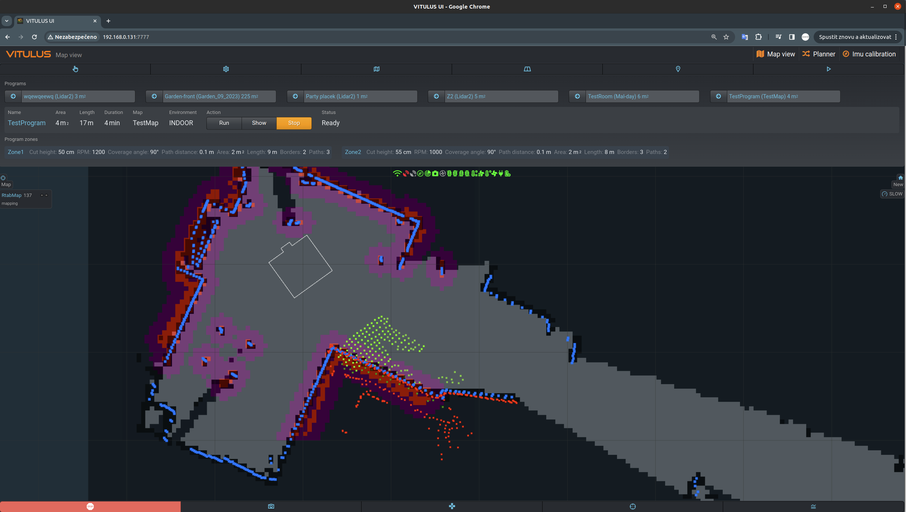

# vitulus_navi
 VITULUS navigation manager.\
 ROS package\
 It's the backend for webUI and manage maps and navigation.
   
 



## Geofence proposals (`src/vitulus_navi/geofence/`)

Robot-native, **propose-only** writer that turns a perimeter *clicked* in the
web-UI map editor into an **UNSIGNED** geofence proposal. It lives here (a
safety-adjacent nav package that ships with the robot) so the public web node
`vitulus_ui/nodes/webnode` (`:7779`) can serve `POST /api/geofence/propose`
without importing anything from the private agent (`vitulus_claude`).

- `fence.py` — verbatim copy of the agent's `geofence.py` (the `Fence`
  geometry/validation the test supervisor also uses; pure stdlib).
- `sitebundle.py` — verbatim copy of the agent's `sitebundle.py`.
- `propose.py` — propose-only port of the agent's `geofence_propose.py`:
  `build_proposal()` / `write_proposal()` convert `map` metres → UTM33, reject
  rings that cross unmapped cells, and write `geofence.proposed.geojson` next to
  the site bundle. Because `fence.py` is a verbatim copy, the ring digest and
  file format match the agent path bit-for-bit.

**Signing is intentionally NOT here.** An active `geofence.geojson` is produced
only by a human running the agent's `tools/geofence_propose sign` (or
`/geofence podepsat <digest>`). This subpackage has no sign function, so nothing
reachable from the web node can arm a fence (AGENT.md §11.1, §11.5). The
canonical geofence *loader* the supervisor consumes remains the agent's
`geofence.py`; the copies here are used only to pre-validate proposals.

## Dependencies note

The global costmap uses the memoryless obstacle layer registered as
`costmap_2d::NonPersistentVoxelLayer`. Despite the `costmap_2d::` prefix, the
plugin is provided by the external package
[`nonpersistent_voxel_layer`](https://github.com/SteveMacenski/nonpersistent_voxel_layer)
(the C++ class lives there as `nonpersistent_voxel_layer::NonPersistentVoxelLayer`;
the `costmap_2d::` name is only the pluginlib registration). Install it with:

```bash
sudo apt install ros-noetic-nonpersistent-voxel-layer
```

## Traversability layer (local costmap, off by default)

The local traversability map of `vitulus_traversability` (`/traversability/local_costmap`, 6 × 6 m in `odom`,
0..99 graded, 100 lethal, -1 unknown) can be added to the **local** costmap of move_base_flex as one more
`costmap_2d::StaticLayer` (`traversability_layer`, before `inflation_layer`; `use_maximum: true`,
`trinary_costmap: false`, `track_unknown_space: false` — the same pattern as `cloud_costmap_layer`). Parameters:
`config/local_costmap_traversability.yaml`.

**Off by default.** `launch/vitulus_navi_mbf.launch` loads that file only when the robot sets

    export VITULUS_TRAVERSABILITY_NAV=true    # this layer in the local costmap

and the node runs: since T10 (stack) the stack starts `traversability_local` by itself
(`vitulus/launch/includes/traversability.launch`; `vitulus.startup` sets `VITULUS_TRAVERSABILITY_NODE=true` when
`vitulus_traversability` is in the workspace, `=false` in `~/.bashrc` turns it off). The older start from
vitulus_depth_obstacles (`VITULUS_TRAVERSABILITY=true`) counts too; with it set `vitulus.startup` switches the stack
start off (`VITULUS_TRAVERSABILITY_NODE=false`), so the node never runs twice (two `/traversability_local` with respawn
would shut each other down endlessly). The switch checks `VITULUS_TRAVERSABILITY_NODE` OR `VITULUS_TRAVERSABILITY`

in `~/.bashrc` (sourced by `vitulus.service`; navi_man starts the navigation launch in its own process, so the
variables must be in its environment). On = `1`, `true`, `yes`, `on` (any case, spaces ignored); anything else
(unset, empty, `false`, a typo), or the layer without the node = off, and the parameters are exactly as without the switch
(`roslaunch --dump-params` / `--nodes` of `vitulus_navi_outdoor.launch`, `vitulus_navi_indoor.launch` and
`vitulus_navi_mbf.launch` identical, `test/test_traversability_switch.py`).

* **Switch on**: add the line, restart the stack (`vitulus.service`) — a restart of navi_man or the navigation
  alone keeps the old environment.
* **Switch off**: remove (or set to `false`) `VITULUS_TRAVERSABILITY_NAV`, restart the stack. The node itself keeps
  running (it only publishes, e.g. for the UI).

Why inside this launch: `vitulus_navi_mbf.launch` starts with `<rosparam command="delete" ns="move_base_flex"/>`,
which runs before its parameters are loaded and wipes every `/move_base_flex/...` parameter set by any other launch
(so `vitulus_traversability traversability.launch nav_integration:=local` cannot configure the layer: started before
the navigation its parameters are deleted, started after it they come too late). The switch loads the layer inside
the `move_base_flex` node after `local_costmap_params.yaml` (the plugin list is replaced as a whole; the list in
`local_costmap_traversability.yaml` must stay `local_costmap_params.yaml` + `traversability_layer`, the test checks
it).

**Needs the node running**: a costmap_2d StaticLayer blocks the start of move_base_flex until the first map on its
topic arrives ("Requesting the map..." in the move_base_flex log). `traversability_local` therefore publishes an
all-unknown map (-1, neutral here: `track_unknown_space: false`, `use_maximum: true`) every 0.5 s from its start
until its first D435 cloud with TF, so a broken camera or missing TF does not hold the navigation. But when the node
does not run at all, move_base_flex waits for good. The node runs only when **all** of these hold:

* `VITULUS_TRAVERSABILITY_NODE=true` (the stack start) or `VITULUS_TRAVERSABILITY=true` (the start from
  vitulus_depth_obstacles; checked by the switch: without either the layer stays off),
* `obstacles_engine: depth_obstacles` in `config/navi_manager.yaml` — only then navi_man starts
  `vitulus_depth_obstacles/depth_obstacles.launch`, the source of the clouds (and of the node with
  `VITULUS_TRAVERSABILITY=true`); with `rtabmap` (the RTABMAP_OBSTACLES container) the stack-started node gets no
  clouds and publishes only its neutral grid, the layer adds nothing. **Not checked by the switch** (the launch cannot
  read navi_manager.yaml): never switch on with `obstacles_engine: rtabmap`,
* `vitulus_traversability` is built on the robot.

Checked locally (own roscore, fake TF and maps, `move_base_flex` of this launch): switched on, the local costmap
carries the traversability cost (lethal 100 → 100, graded 50 → 49, unknown → 0) and a stale `/move_base_flex/...`
parameter from before is gone; with the real `traversability_local` and no camera at all the local costmap is
published (neutral grid); with no traversability publisher at all it is not published (move_base_flex waits) and
comes up when a map arrives.
